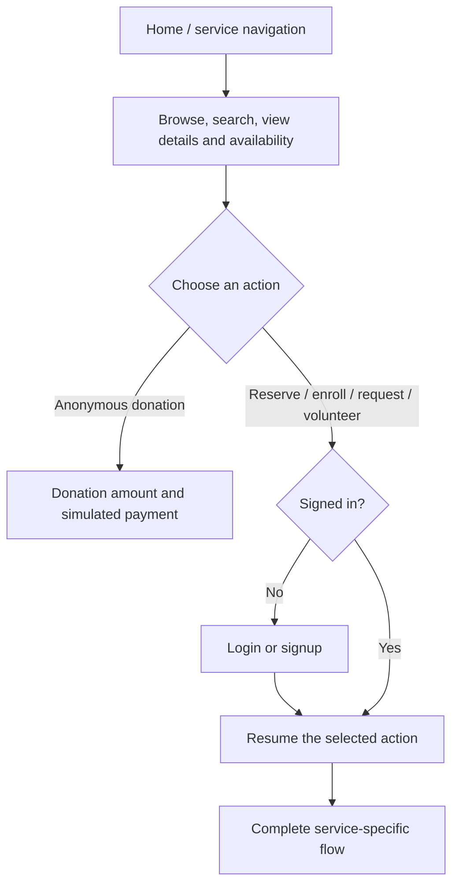
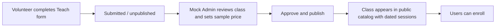
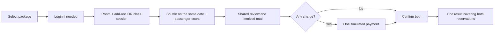

# Best Community Service — Application Flow Handoff

This file describes the coded interactive prototype for the teammate building its Figma equivalent. Give this entire file and the source folder to your agent. The implemented code is the behavior reference; the design file records the approved scope. Preserve the existing visual style rather than designing a different application.

## 1. What this website is

Best Community Service is a nonprofit community center's online service desk. Its five core services are Rooms, Classes, Transportation, Home Care, and Donations. Packages combine Room + Shuttle or Classes + Shuttle. People can receive services or volunteer to provide classes, driving, and home care.

This is a client-side demonstration, not a deployed business system. All names, addresses, routes, availability, and prices are fictional. Payments and authentication are simulated. There is no database, real email, driver dispatch, payment processor, or live user data.

The previous neighborhood social application was incorrect and has been replaced. Do not restore its feed, posts, groups, messages, points, leaderboard, membership approval, moderation, or social-help task lifecycle.

## 2. Visual direction to preserve

- Forest green `#255b45`, dark green `#244d3c`, cream `#f5f2e8`, page background `#f8f9f5`, white cards, muted sage accents.
- DM Sans for body text and Manrope for headings; selected large hero text uses italic Georgia.
- Green prototype strip, white left sidebar, restrained header/breadcrumb, rounded cards, thin borders, green primary buttons, outlined secondary buttons.
- A warm community-center illustration and simple outlined service icons.
- Desktop: persistent sidebar and multi-column cards/forms. Mobile: hamburger sidebar, stacked cards/forms, collapsible navigation overlay.
- Original styling foundation: `src/styles.css`. New service layouts and responsive overrides: `src/services/styles.css`, imported after the foundation in `src/main.tsx`.
- New visual references live in `docs/screenshots/redo/`. Older screenshots outside that directory show the superseded application; they are NOT flow references.

## 3. Global navigation and access

Sidebar destinations:

1. Home
2. Rooms
3. Classes
4. Transportation
5. Home Care
6. Donations
7. Packages

Mock Admin is available through the prototype strip, with a mock admin sign-in. Once signed in as admin, it also appears in the sidebar. It is a deliberately limited prototype extension, not a full staff product.

**Guests:** may browse, search, inspect service details and calendars, and donate anonymously. A service action requires an account, except anonymous donation.

**Registered users:** may book/enroll/request services and submit volunteer offerings. The prototype does not require volunteer approval. Signup allows multiple volunteer interests: Teach, Drive, Give Home Care. Interests are descriptive and do not lock users out of the other volunteer forms.

**Shared controls:** brand returns Home; sidebar changes services; cancellation returns to the originating service; Back/Edit returns to earlier steps; success returns to the service listing through “Back to services.” Starting navigation elsewhere discards an unsubmitted form. Mobile hamburger opens the sidebar and selecting a destination closes it.

## 4. Login, signup, logout, and recovery

### Login

Entry points: header “Log in / Sign up,” sidebar “Log in,” or an account-required action.

1. Enter email and password, or use the visible demo shortcut.
2. Invalid credentials show an inline error.
3. On success, a previously selected action resumes (room reservation, teaching form, registered donation, etc.). If no action was pending, the current browsing view remains.
4. “Back to browsing” cancels authentication without performing the action.

Demo member: `maya@example.test` / `neighborly`; “Continue as Maya” provides the same demonstration shortcut.

### Signup

From login choose “Create an account.” Fields: full name, email, password (at least eight characters), mailing address; optional multiple volunteer-interest checkboxes.

Duplicate email and blank name/address are rejected. Creating an account signs the user in and resumes the intended action. There is no neighborhood membership or account-approval step.

### Recovery

“Forgot password?” accepts an email and displays that recovery was simulated. No email is sent. “Back to log in” returns to login.

### Logout

Sidebar logout clears the current identity and active form, returning admin users to Home. Other users can keep browsing the current service. It does not erase already submitted mock data.

## 5. Home and search

Home shows the service overview, five service cards, and a Packages banner.

- “View services” scrolls to the cards.
- Search services filters the five service categories by name/description.
- Service buttons such as “Reserve a room,” “View classes,” and “Donate” open their respective sections.
- Each service catalog has its own keyword search for sample offerings; an empty result is explicitly shown.
- Search and details do not require login.

## 6. Shared availability, review, and payment behavior

Calendars show sample available dates, disabled unavailable dates, a selected-date state, and a date input. Sample catalogs initialize relative to the day the prototype is opened. Seeded availability spans approximately four weeks. The date input can also select later dates on an approved recurring class's schedule; dates not in that service's availability are rejected.

Room/home-care forms also offer quick-select time slots and editable start/end times. Occupied quick slots are disabled. Final validation prevents overlapping reservations even if a user types times manually.

**Shared review:** show the selected service, date/time, relevant details, contact information, itemized charges, and total. Edit returns to the details form. No booking is saved merely by opening review.

**Paid services:** review → “Continue to simulated payment” → clearly labeled payment preview → “Simulate payment” → result. Never collect real card data. No money moves.

**Free services:** review → confirm (or submit a ride request) → result. No payment step.

Confirmation commits the mock transaction. On validation failure, show the error and leave the reservation uncommitted. Existing confirmed totals are preserved when admin changes future sample prices.

## 7. Rooms — reserve event space

Rooms are physical spaces at the community center for events such as weddings, meetings, and funerals. Those event examples are not separate services.

### Flow

Rooms catalog → View details → browse availability → “Reserve room” → login if necessary → room/date/time/details → optional add-on pop-up → review → simulated payment if paid → confirmation.

### Reservation fields

- Room
- Date
- Start and end time
- Event name or type
- Expected attendance

### Optional add-on pop-up

“Choose add-ons” opens a dialog with:

- Catering guest count, charged per person; one simple vendor catering option.
- Room-cleaning checkbox, charged per reservation.
- Tables, quantity charged per table.
- Chairs, quantity charged per chair.

All default to none/zero. “Save add-ons” closes the pop-up and updates the running summary. Escape, close button, or clicking the overlay also closes it; entries remain in the current draft. These are optional room sub-services, never standalone main services.

### Pricing and validation

Room fee = selected hours × room hourly rate. Add catering, cleaning, tables, and chairs. Show itemized charges.

Require a valid available date, ordered times within room hours, event name, whole-number attendance within capacity, nonnegative whole-number add-on quantities, and catering count not exceeding attendance. Reject conflicting room bookings; adjacent intervals are allowed.

### Result

“Reservation confirmed.” Show service, date/time, reference, and simulated amount paid (or free status).

## 8. Classes — Take

Classes catalog → keyword browse → View details → select available date → “Enroll in class” → login if needed → select class/session → review → optional simulated payment → enrollment confirmation.

Details show description, language, level, prerequisites, volunteer teacher designation, location, schedule, price per session, and places available.

The selected occurrence is one dated session. A weekly listing does not mean enrolling in or paying for the whole series. One enrollment reserves one place, including through a package. Full sessions cannot be booked.

Initial samples: Spanish, arts and crafts, and painting. Variations reuse the same screen structure.

## 9. Classes — Teach and approval

Classes → “Teach a class” → login if needed → calendar availability/course form → “Submit class” → “Class submitted.”

Fields:

- First/session date and start/end time
- Class title and description
- Language, level, prerequisites
- Schedule: one-time or recurring weekly
- Recurring end date when weekly is selected; weekday comes from the first date

Require the course fields, valid times, and valid recurrence bounds. Do not ask for certification uploads. Teaching is voluntary; no instructor-payment system exists.

**State transition:**

A submitted class is NOT immediately visible in public search or listings. Only mock admin approval publishes it. Approval preserves the volunteer's course details and creates its one-time/weekly dates. New classes use a sample capacity of 20 and Community Center location. No rejection, appeals, or instructor-management screens are implemented.

## 10. Transportation — scheduled shuttle

Transportation → “Scheduled shuttles” → view a trip → inspect route/departure/arrival/availability → “Reserve shuttle” → login if needed → date and passenger count → review → optional simulated payment → confirmation.

Show route, pickup stop/location, departure time, arrival time, price per passenger, and remaining seats. Reserve a positive whole-number passenger count no greater than availability. Confirming reduces the remaining seats for that trip/date.

Seed routes are fictional Library, Northside, and return shuttles. Their regular sample departures repeat over the seeded date range. The prototype assumes shuttle staffing is arranged; it does not implement guaranteed-driver scheduling.

## 11. Transportation — on-demand ride

Transportation → “On-demand rides” → View On-demand ride → “Request a ride” → login if needed → request form → review → optional simulated payment → request-submitted result.

Fields: pickup date/time, pickup address, destination, passenger count (one to four).

This is a flexible request, not an existing scheduled trip. The result must say “Ride request submitted.” and explain that no driver is assigned and the ride is not guaranteed. Do not display a driver, live location, dispatch status, or guaranteed pickup.

## 12. Transportation — Drive

Transportation → “Volunteer to drive” → login if needed → availability and qualifications form → submit → acknowledgment.

Fields: date, start/end time; one or both of Scheduled shuttle and On-demand ride; qualifications text.

At least one transportation mode is required. Both can be selected. The availability submission is stored in the current mock state but does not automatically publish a trip or assign the volunteer. No driver approval queue is implemented.

## 13. Home Care — Take

Home Care → browse Home cleaning / Nursing / Welfare check → view details/calendar → “Request home care” → login if needed → available date/time → recipient details → review → simulated payment if paid → confirmation.

Fields: selected care service, date, start/end time, recipient name, home address, short description of assistance needed. Name/address prefill from the signed-in user but can be changed for the recipient.

Services happen at the recipient's home. This is separate from cleaning the community-center room after an event. No medical record, care plan, provider matching, or clinical workflow is present.

Require recipient/address/assistance and valid available times. Confirmed appointments block overlapping times for that sample care posting.

## 14. Home Care — Give

Home Care → “Provide home care” → login if needed → availability/qualifications form → submit → acknowledgment.

Fields: date, start/end time; one or more of Home cleaning, Nursing, Welfare check; qualifications text. At least one service is required. No file uploads.

The submission records availability, not a booked appointment or automatic assignment. No caregiver approval queue is implemented.

## 15. Donations — anonymous

Donations → “Donate anonymously” → positive amount → “Review donation” → simulated payment → thank-you confirmation.

No login, name, email, or address is required. If the visitor is already signed in, choosing this track still omits their user ID and donor details from the mock donation record.

The result shows the simulated amount and states that no donor identity is attached. No registered-donor receipt is created for this path. The lecture's discussion of payment traceability is business context; there is no real payment information to track in this prototype.

## 16. Donations — registered

Donations → “Donate with an account” → login if needed → amount and donor information → review → simulated payment → thank-you and sample receipt.

Fields: positive amount, donor name, email, mailing address. Identity fields prefill from the account and are editable for the receipt.

The on-screen receipt shows donor details, amount, reference, and “SAMPLE RECEIPT — NOT A TAX DOCUMENT.” No real receipt email or tax document is produced.

## 17. Packages

Both components remain available separately. The package is a connected flow, not a new kind of service or a discount. It reuses the signed-in contact and the selected date, avoiding duplicate entry.

### Room + Shuttle

Packages → Book Room + Shuttle → select room/date/time/event/attendance and optional add-ons → “Continue to shuttle” → select a trip and passenger count → review both services → one simulated payment if paid → package confirmation.

### Classes + Shuttle

Packages → Book Classes + Shuttle → class/session → “Continue to shuttle” → trip/passenger count → shared review → one simulated payment if paid → package confirmation.

### Shared rules

- Shuttle date comes from the room/class selection.
- Show route, departure, and arrival so the user can choose an appropriate trip; do not claim automatic itinerary matching.
- Passenger count describes the number of shuttle seats reserved; it need not equal room attendance.
- Total is the sum of the selected service, room add-ons if any, and shuttle seats. No package fee or discount.
- Both parts are validated before either is committed. Insufficient shuttle seats or a conflicting room/class selection cannot leave half a package booked.
- Edit details returns to the service step; selecting a different date requires choosing a shuttle for that date again.

## 18. Mock Admin

### Access

Prototype strip “Mock Admin” → mock admin login → “Continue as Demo Admin,” or enter `admin@example.test` / `neighborly`.

Ordinary signup does not create an admin. This control demonstrates a role; it is not secure production authorization. Entering the mock admin replaces the current demo identity; data already submitted remains in the same tab.

### Class approvals

Default tab shows pending class submissions. Each includes course title, description, volunteer name, date/time/weekly schedule, language, level, prerequisites, and a price-per-session field.

Enter a nonnegative sample fee (zero means free) → “Approve and publish” → pending item disappears → class appears in Classes and can be enrolled in. Approval is only for teaching submissions.

No pending room bookings, class enrollments, driver/caregiver applications, care bookings, or ride requests appear here. Those flows use their documented confirmation or request-submitted behavior.

### Sample pricing

“Sample pricing” tab → edit prices per posting and room add-on → “Save sample prices.”

Prices update public listings and subsequent booking calculations. Units remain explicit:

| Posting/add-on  | Unit             | Initial fictional price |
| --------------- | ---------------- | ----------------------: |
| Community Hall  | Hour             |                     $80 |
| Meeting Room    | Hour             |                     $40 |
| Spanish         | Selected session |                    Free |
| Arts and crafts | Selected session |                     $10 |
| Painting        | Selected session |                     $15 |
| Each shuttle    | Passenger        |                      $5 |
| On-demand ride  | Request          |                     $10 |
| Home cleaning   | Appointment      |                     $20 |
| Nursing         | Appointment      |                    Free |
| Welfare check   | Appointment      |                    Free |
| Catering        | Person           |                      $8 |
| Room cleaning   | Reservation      |                     $20 |
| Tables          | Each             |                      $5 |
| Chairs          | Each             |                      $1 |

These amounts were chosen for demonstration, not supplied by the instructor. Prices can be changed to zero. No negative/non-finite prices are accepted.

## 19. Prototype state, reset, and limitations

- All mock state lives in memory in the current browser tab.
- Navigating within the app preserves bookings, prices, donations, and class submissions/approvals.
- Refreshing the page or opening a separate tab starts a new dataset and signs out. There is no shared state between browsers/tabs/devices.
- “Reset demo” asks for confirmation, then clears mock accounts, bookings, submissions, donations, prices, and identity, regenerating sample dates.
- Login passwords are not written to local storage. Use fictional credentials; this is not a production authentication system.
- Paid transactions always identify themselves as simulations; no payment details are collected.
- No cancellation/refund system, email delivery, dispatch, staff operations, or general account-management dashboard is included.

## 20. Requirement provenance — preserve these boundaries

**Directly from assignment/lecture:** five core services; Rooms with calendar/time/details and optional catering/cleaning/equipment; Teach/Take, Drive/Take, Give/Take patterns; availability and provider qualifications; scheduled shuttle vs on-demand ride; anonymous/registered donation tracks; Room + Shuttle and Classes + Shuttle packages with shared data; reusable calendars/lists/forms/payments; simple user-facing prototype without required backend.

**Clarified/approved by the user:** guest browsing and account-gated service actions; anonymous donations without accounts; multiple volunteer selections; tables/chairs as equipment; one-time and weekly classes; specific booking fields; no certification uploads; simulated payments; shared package review/payment; passenger-count shuttle reservations; limited mock pricing admin; pending classes published after admin approval; preserve original visual style.

**Builder-selected samples/defaults:** room names/capacities, routes/times, dated availability, prices, default care/class capacity, per-occurrence recurring enrollment, and in-memory tab lifetime. Do not treat these samples as instructor-mandated business rules.

## 21. Code map and verification

- `src/App.tsx`: navigation, identity, login continuation, shared state, reset, shell.
- `src/Auth.tsx`: existing-style login/signup/recovery adapted to the service application.
- `src/services/model.ts`: catalog/types, quotes, availability checks, booking commit, class submission/publication, donation privacy.
- `src/services/Catalog.tsx`: Home, service lists/details, package entry cards.
- `src/services/Booking.tsx`: individual and bundled reservations, add-on dialog, review, payment, result.
- `src/services/Offering.tsx`: teaching/driving/caregiving submissions.
- `src/services/Donations.tsx`: donation landing, both tracks, simulated payment/receipt.
- `src/services/Admin.tsx`: class approval and sample prices.
- `src/services/ui.tsx`: reusable labeled fields, availability calendar, dialog, titles, results, illustration.
- `src/services/model.test.ts`: business-rule regression tests.
- `tests/e2e/services.spec.ts`: browser workflows and visual reference captures.

Run locally with `npm install`, then `npm run dev`. Run checks with `npm test`, `npm run build`, and `npm run test:e2e -- --workers=1` (Chromium must be installed for Playwright).

For Figma, reproduce each path's entry/list/detail, form, validation, review, payment/free branch, result, and admin approval states. Reuse common components and the supplied visual language. Keep every visible action linked to its corresponding state; do not add unrelated functionality.
